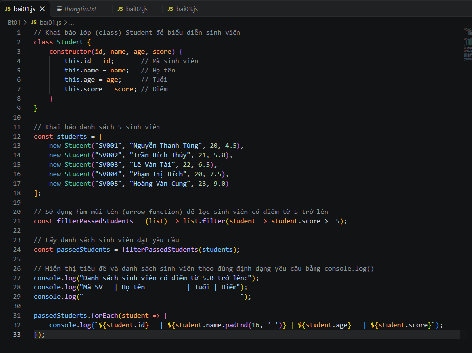
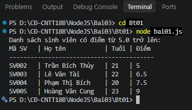

BÀI 01: QUẢN LÝ THÔNG TIN SINH VIÊN BẰNG JAVASCRIPT ES6

1. Các lệnh thực hiện

Chạy chương trình:

bash

cd bai03/Bt01

node bai01.js

2. Ảnh thực hiện bài tập
Ảnh chạy chương trình

!Chạy chương trình

Ảnh kết quả

!Kết quả

3. Kết quả

Chương trình hiển thị danh sách sinh viên có điểm từ 5 trở lên bằng console.log().
