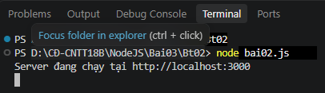
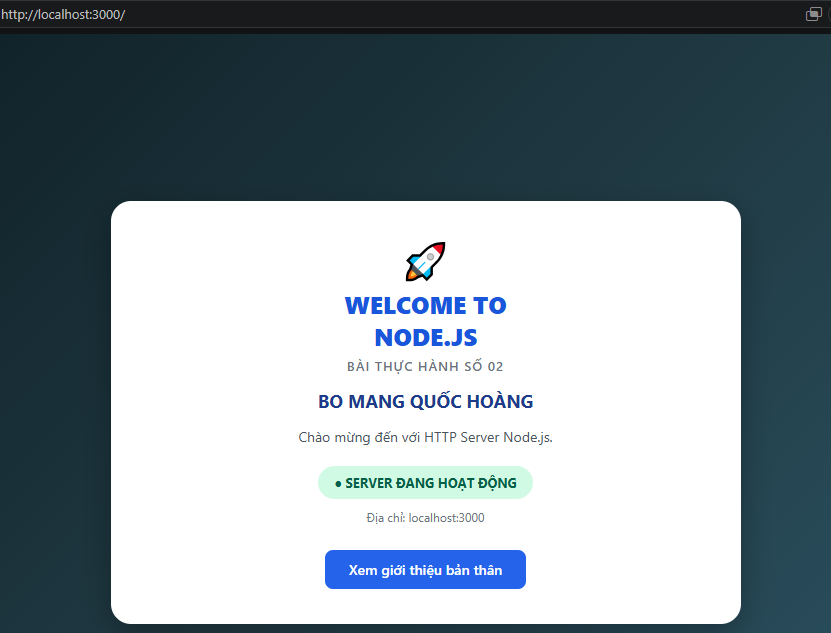
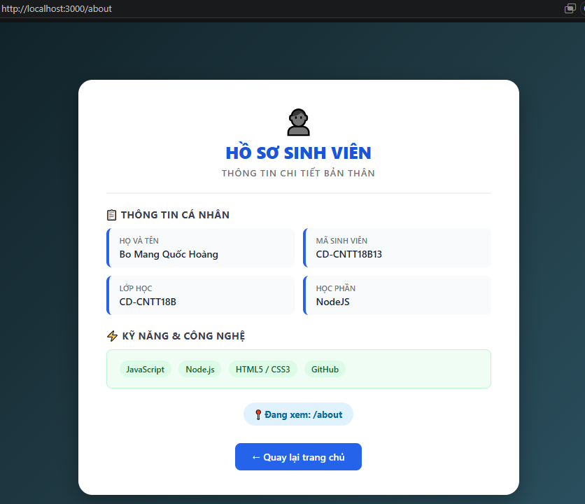
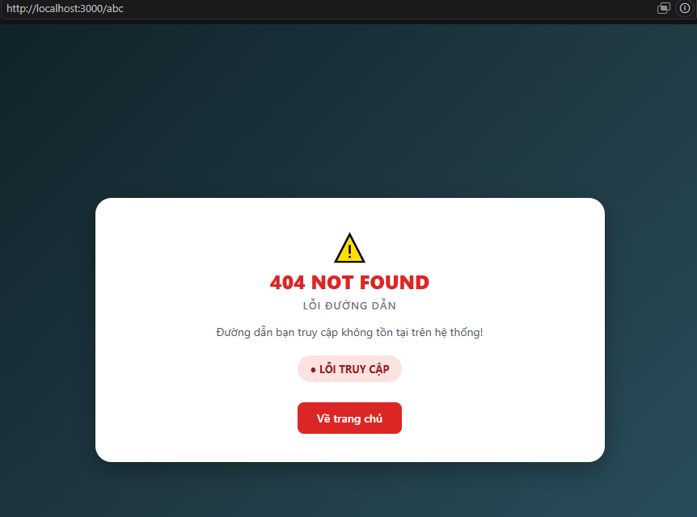

Bài 2. Tạo Web Server với Node.js

1. Các lệnh thực hiện

Di chuyển vào thư mục Bt02:

bash

cd Bt02

Chạy chương trình:

bash

node bai02.js

Sau khi chạy, Web Server hoạt động tại cổng 3000.

2. Kết quả thực hiện
Hình 1: Chạy Web Server

Hình 2: Trang chủ

Truy cập địa chỉ:

text
http://localhost:3000

Hình 3: Trang giới thiệu

Truy cập địa chỉ:

text
http://localhost:3000/about

Hình 4: Kiểm tra lỗi 404

Truy cập một đường dẫn không tồn tại để kiểm tra mã trạng thái HTTP 404.

3. Kết luận

Qua bài thực hành, em đã biết cách sử dụng module http trong Node.js để tạo Web Server, xử lý các đường dẫn truy cập và trả về mã trạng thái HTTP phù hợp.

Kết quả: Hoàn thành bài tập tạo Web Server với Node.js.
