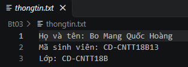
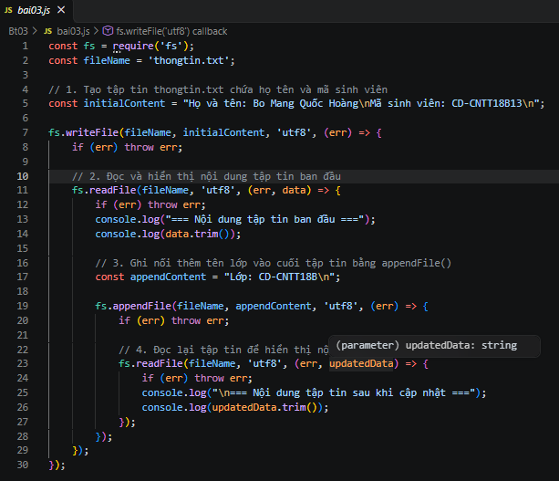
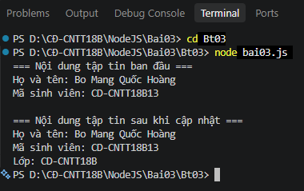

BÀI 3: THAO TÁC TẬP TIN BẰNG FILE SYSTEM

1. Các lệnh thực hiện

Di chuyển vào thư mục Bt03:

bash

cd Bt03

Chạy chương trình:

bash

node bai03.js

2. Hình ảnh thực hiện

Hình 1: Nội dung tập tin thongtin.txt

Hình 2: Code chương trình bai03.js

Hình 3: Kết quả chạy chương trình trên Terminal

3. Kết quả

Tập tin thongtin.txt được tạo thành công.
Nội dung họ tên và mã sinh viên được ghi vào tập tin.
Chương trình đọc và hiển thị nội dung tập tin lên Terminal.
Tên lớp được ghi nối thêm vào cuối tập tin bằng appendFile().
Đọc lại tập tin và hiển thị đầy đủ nội dung sau khi cập nhật.

4. Kết luận

Qua bài thực hành, em đã biết cách sử dụng module fs trong Node.js để tạo, đọc và ghi nối thêm nội dung vào tập tin.

Kết quả: Hoàn thành bài tập thao tác tập tin bằng File System.
