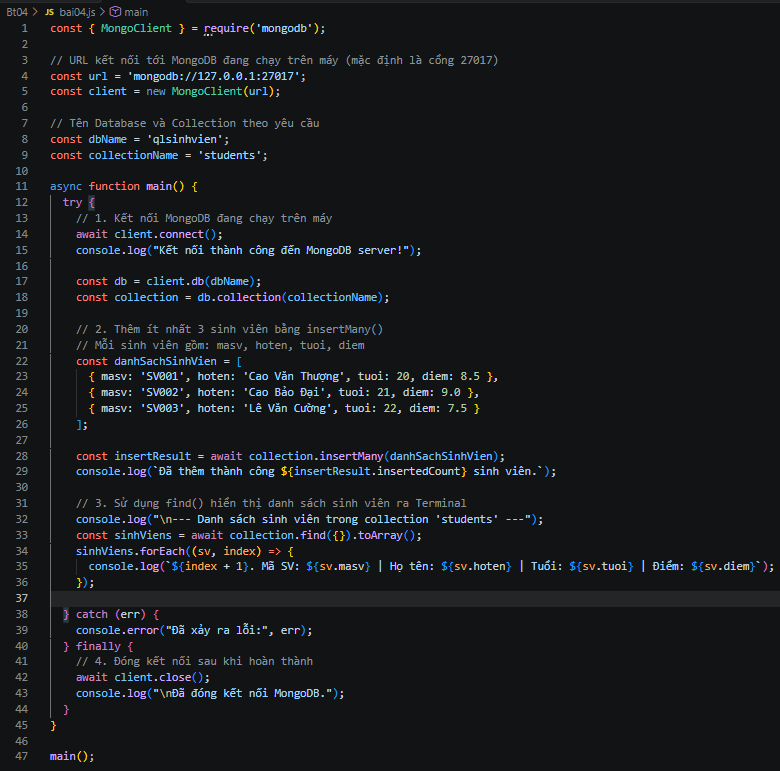
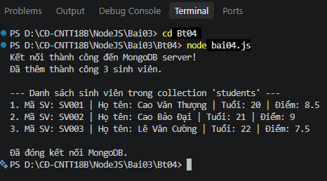
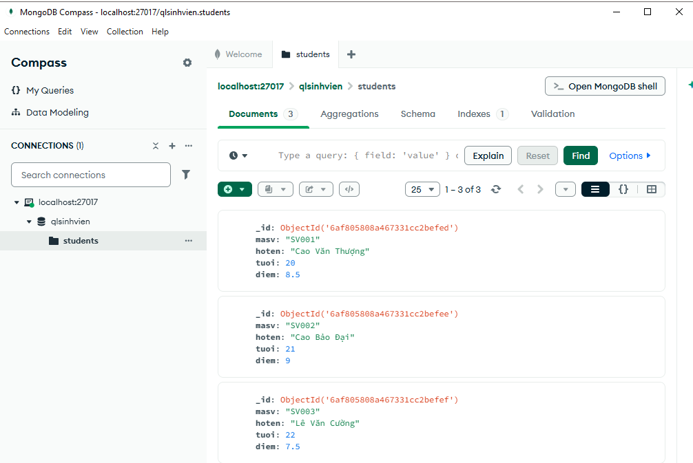

BÀI 4: THÊM VÀ HIỂN THỊ DỮ LIỆU MONGODB

1. Các lệnh thực hiện

Di chuyển vào thư mục Bt04:

Bash

cd Bt04

Cài đặt thư viện MongoDB Driver:

npm install mongodb

Chạy chương trình:

node bai04.js

---

2. Hình ảnh thực hiện

**Hình 1: Code chương trình `bai04.js`**

**Hình 2: Kết quả chạy chương trình trên Terminal**

**Hình 3: Kiểm tra kết quả trong MongoDB Compass**

---

3. Kết quả

* Kết nối thành công tới MongoDB server đang chạy trên máy (`mongodb://127.0.0.1:27017`)[cite: 4, 5].
* Sử dụng cơ sở dữ liệu `qlsinhvien` và collection `students`[cite: 1, 4].
* Thêm thành công 3 sinh viên (`Cao Văn Thượng`, `Cao Bảo Đại`, `Lê Văn Cường`) kèm theo các thông tin `masv`, `hoten`, `tuoi`, `diem` bằng phương thức `insertMany()`[cite: 3, 4, 5].
* Sử dụng phương thức `find()` để truy vấn và hiển thị danh sách sinh viên trực tiếp ra màn hình Terminal[cite: 1, 4, 5].
* Đóng kết nối cơ sở dữ liệu an toàn sau khi hoàn thành công việc[cite: 1, 4, 5].
* Kiểm tra và xác thực dữ liệu được lưu trữ thành công trên giao diện quản lý MongoDB Compass[cite: 3].

---

4. Kết luận

Qua bài thực hành, em đã biết cách sử dụng thư viện `mongodb` trong Node.js để kết nối cơ sở dữ liệu NoSQL, thực hiện thêm dữ liệu hàng loạt bằng `insertMany()`, truy vấn dữ liệu bằng `find()` và quản lý vòng đời kết nối an toàn.

**Kết quả:** Hoàn thành bài tập thêm và hiển thị dữ liệu MongoDB.