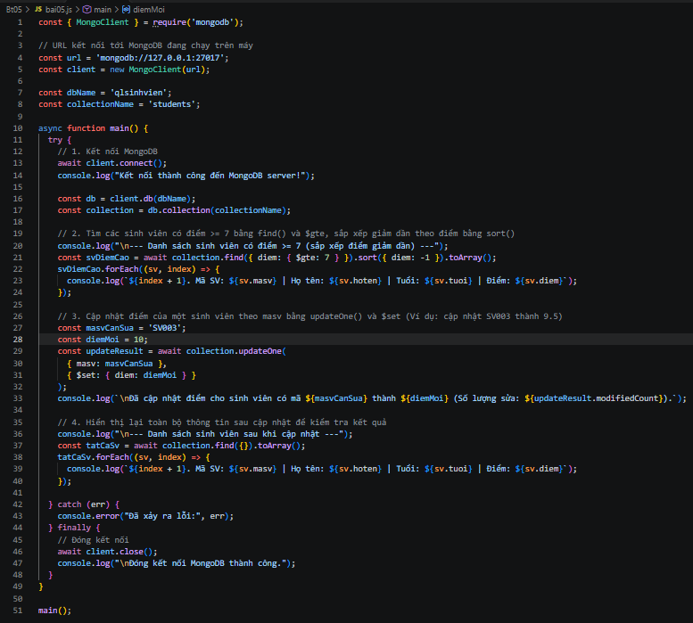
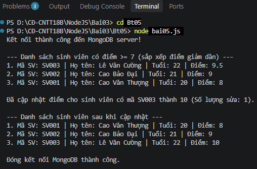
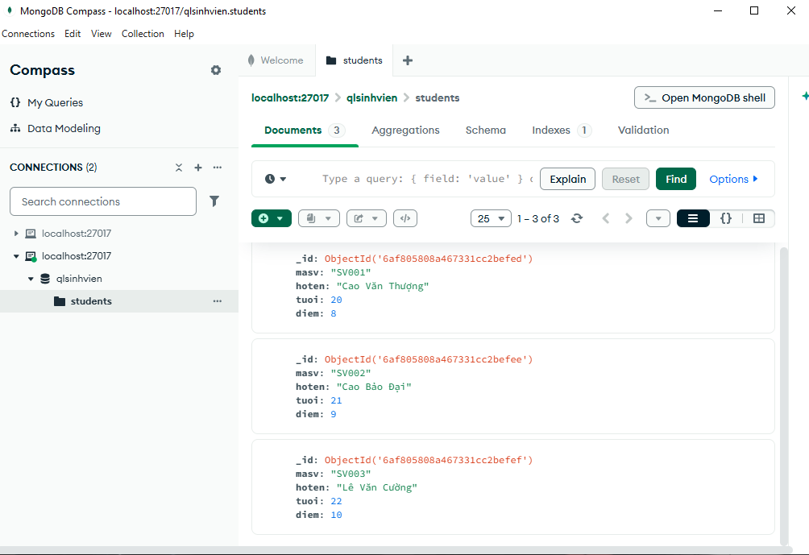

BÀI 5: TÌM KIẾM, CẬP NHẬT VÀ SẮP XẾP MONGODB

1. Các lệnh thực hiện

Di chuyển vào thư mục Bt05:

cd Bt05

Chạy chương trình:

node bai05.js

2. Hình ảnh thực hiện

Hình 1: Code chương trình bai05.js

Hình 2: Kết quả chạy chương trình trên Terminal

Hình 3: Kiểm tra kết quả trong MongoDB Compass

3. Kết quả

Kết nối thành công tới MongoDB server đang chạy trên máy (mongodb://127.0.0.1:27017).

Sử dụng collection students từ cơ sở dữ liệu qlsinhvien của bài trước.

Tìm kiếm thành công danh sách các sinh viên có điểm ≥7 bằng phương thức find() kết hợp toán tử truy vấn $gte.

Sắp xếp kết quả trả về theo thứ tự điểm số giảm dần thành công bằng phương thức sort().

Cập nhật thành công điểm của sinh viên theo mã số sinh viên (masv) cụ thể bằng phương thức updateOne() kết hợp với toán tử $set.

Đọc và hiển thị lại toàn bộ thông tin danh sách sinh viên sau khi cập nhật trực tiếp lên màn hình Terminal để kiểm chứng kết quả.

Đóng kết nối cơ sở dữ liệu an toàn sau khi hoàn thành.

4. Kết luận
Qua bài thực hành, em đã biết cách sử dụng các toán tử truy vấn điều kiện nâng cao, phương thức sắp xếp dữ liệu cũng như thao tác cập nhật bản ghi trong cơ sở dữ liệu NoSQL MongoDB bằng Node.js.

Kết quả: Hoàn thành bài tập tìm kiếm, cập nhật và sắp xếp dữ liệu MongoDB.