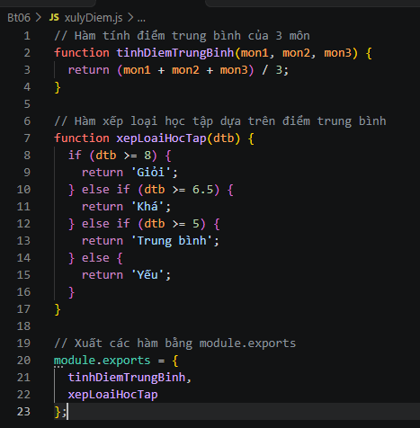
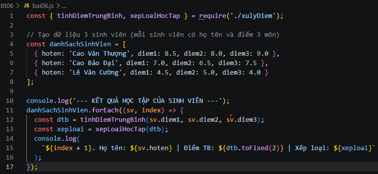
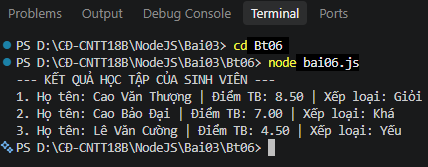

# BÀI 6: XÂY DỰNG MODULE TÍNH KẾT QUẢ HỌC TẬP

## 1. Các lệnh thực hiện

Di chuyển vào thư mục `Bt06`:

``bash``

cd Bt06

Chạy chương trình:

``bash``

node bai06.js

## 2. Hình ảnh thực hiện

### Hình 1: Code module

### Hình 2: Code chương trình

### Hình 3: Kết quả chạy chương trình trên Terminal

## 3. Kết quả

Xây dựng thành công module xulyDiem.js gồm hàm tính điểm trung bình 3 môn và hàm xếp loại học tập (Giỏi từ 8, Khá từ 6.5, Trung bình từ 5, Yếu dưới 5).

Xuất các hàm từ module bằng module.exports và gọi lại trong bai06.js bằng require().

Khởi tạo dữ liệu cho 3 sinh viên và hiển thị đầy đủ họ tên, điểm trung bình cùng xếp loại học tập trên Terminal.

## 4. Kết luận

Qua bài thực hành, em đã biết cách tách logic xử lý thành module riêng trong Node.js, xuất hàm bằng module.exports và tái sử dụng thông qua require().

