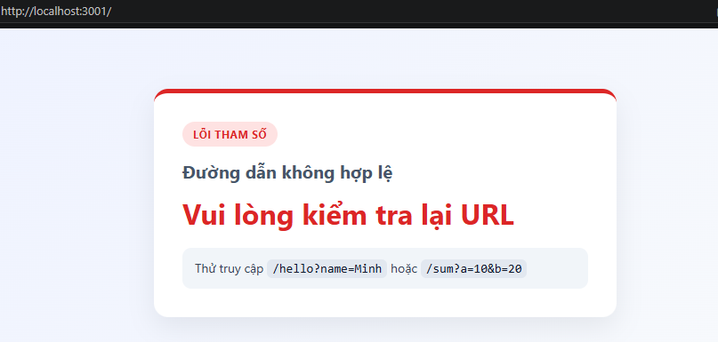
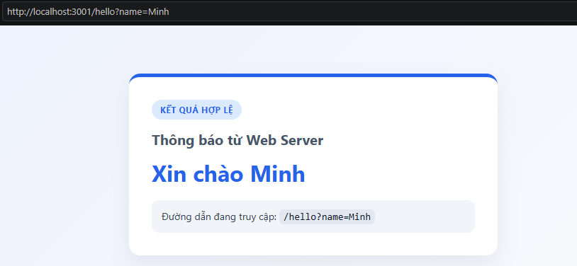

# BÀI 7: XỬ LÝ THAM SỐ URL TRÊN WEB SERVER

## 1. Các lệnh thực hiện

Di chuyển vào thư mục `Bt07`:

```bash

cd Bt07

Chạy chương trình:

```bash

node bai07.js

## 2. Hình ảnh thực hiện

Hình 1: Kết quả chạy Web Server trên Terminal


Hình 2: Truy cập địa chỉ

text http://localhost:3001



Hình 3: Kết quả truy cập `/hello?name=Minh`



Hình 4: Kết quả truy cập `/sum?a=10&b=20`


3. Kết quả

Tạo thành công Web Server bằng module http và xử lý tham số truy vấn qua đối tượng URL tại cổng 3001.

Tách riêng phần định dạng giao diện sang tệp style.css và kết nối vào trang HTML trả về từ server giúp giao diện rõ ràng, dễ nhìn.

Kiểm tra localhost:3001 và truy cập /hello?name=Minh hiển thị chính xác Xin chào Minh.

Truy cập /sum?a=10&b=20 hiển thị chính xác Tổng = 30.

Trả về thông báo lỗi rõ ràng khi thiếu tham số hoặc giá trị truyền vào không hợp lệ.

4. Kết luận

Qua bài thực hành, em đã biết cách xây dựng Web Server với module http, đọc và phân tích tham số URL, kiểm tra dữ liệu đầu vào cũng như tách CSS ra tệp riêng để tổ chức mã nguồn gọn gàng hơn.
