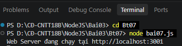
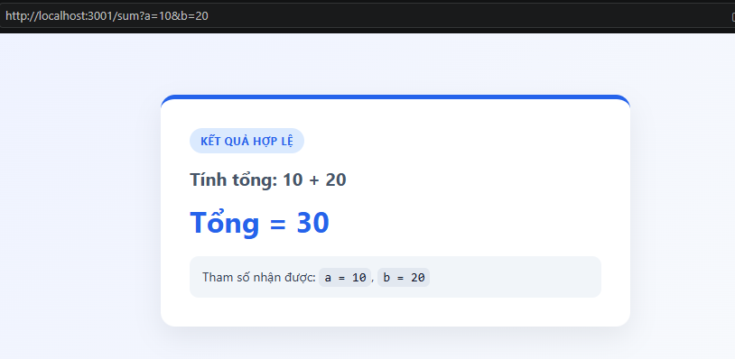

# BÀI 7: XỬ LÝ THAM SỐ URL TRÊN WEB SERVER

## 2. Các lệnh thực hiện

Di chuyển vào thư mục `Bt07`:

```bash
cd Bt07
```

Chạy chương trình:

```bash
node bai07.js
```

Các đường dẫn kiểm tra trên trình duyệt:

- Kiểm tra trang chủ / route mặc định: `http://localhost:3001/`
- Kiểm tra route lời chào: `http://localhost:3001/hello?name=Minh`
- Kiểm tra route tính tổng: `http://localhost:3001/sum?a=10&b=20`

---

## 3. Hình ảnh thực hiện

### Hình 1: Khởi động Web Server trên Terminal

Chạy chương trình thành công với lệnh `node bai07.js`, server thông báo đang lắng nghe tại địa chỉ `http://localhost:3001`:



---

### Hình 2: Kiểm tra truy cập địa chỉ http://localhost:3001

Truy cập địa chỉ root mặc định, server trả về thông báo lỗi đường dẫn kèm gợi ý các cú pháp URL hợp lệ:


---

### Hình 3: Kết quả truy cập route /hello?name=Minh

Web Server tiếp nhận tham số `name=Minh` qua URL và hiển thị lời chào "Xin chào Minh" với giao diện định dạng thẻ card:


---

### Hình 4: Kết quả truy cập route /sum?a=10&b=20

Web Server trích xuất 2 tham số `a=10` và `b=20`, thực hiện ép kiểu số và tính toán hiển thị chính xác kết quả "Tổng = 30":



---

## 4. Kết quả đạt được

- **Tạo Web Server:** Khởi tạo thành công Web Server bằng module `http` tích hợp sẵn trong Node.js, hoạt động ổn định tại cổng `3001`.
- **Tách và phục vụ file tĩnh:** Tách riêng định dạng giao diện sang tệp `style.css` và phục vụ thông qua endpoint `/style.css`, giúp mã nguồn HTML trong `bai07.js` gọn gàng, giao diện hiển thị hiện đại với hiệu ứng card và badge.
- **Xử lý tham số URL:** Sử dụng đối tượng `URL` chuẩn WHATWG để phân tích cú pháp truy vấn, trích xuất dữ liệu qua `searchParams.get()` chính xác và bảo mật.
- **Xử lý các tuyến đường (Routing):**
  - Route `/hello?name=Minh`: Hiển thị chính xác thông báo **"Xin chào Minh"**.
  - Route `/sum?a=10&b=20`: Chuyển đổi chuỗi sang số (`Number`) và tính toán hiển thị chính xác **"Tổng = 30"**.
  - Tuyến mặc định `/`: Bắt các URL không hợp lệ và hiển thị thông báo hướng dẫn.
- **Kiểm soát và xử lý ngoại lệ (Validation):**
  - Kiểm tra trường hợp thiếu tham số hoặc tham số rỗng.
  - Sử dụng `Number.isNaN()` để phát hiện và báo lỗi khi tham số `a` hoặc `b` không phải là số hợp lệ.
  - Hiển thị badge trạng thái tương ứng: `KẾT QUẢ HỢP LỆ` (màu xanh) hoặc `LỖI THAM SỐ` (màu đỏ).

---

## 5. Kết luận

Qua bài thực hành, em đã nắm vững các kiến thức:
1. Cách xây dựng và quản lý vòng đời một Web Server cơ bản bằng Node.js với module `http`.
2. Phục vụ tài nguyên tĩnh (static file CSS) bằng module `fs` kết hợp thiết lập `Content-Type: text/css`.
3. Phân tích đường dẫn URL và trích xuất tham số Query String bằng đối tượng `URL`.
4. Kỹ năng kiểm tra tính hợp lệ của dữ liệu đầu vào (input validation) và xử lý ngoại lệ trước khi tính toán.
5. Tổ chức mã nguồn khoa học, phân tách tầng giao diện (CSS) và tầng xử lý logic phía server.
