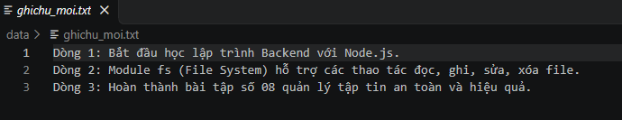
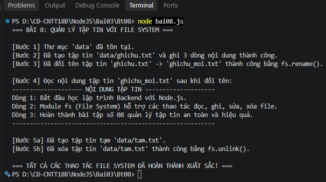

# BÀI 8: QUẢN LÝ TẬP TIN VỚI FILE SYSTEM (FS)

## 1. Mục tiêu bài tập

- Nắm vững việc sử dụng module tích hợp sẵn `fs` (File System) trong Node.js để quản lý tệp tin và thư mục.
- Tự động tạo thư mục `data` và tạo mới tập tin `ghichu.txt`.
- Ghi nội dung gồm ít nhất 3 dòng vào tệp tin bằng mã hóa UTF-8.
- Đổi tên tệp tin từ `ghichu.txt` thành `ghichu_moi.txt` bằng hàm `fs.rename()`.
- Đọc và hiển thị nội dung tệp tin ra màn hình Terminal sau khi đổi tên bằng `fs.readFile()`.
- Tạo một tệp tin tạm `tam.txt`, sau đó xóa tệp tin này bằng hàm `fs.unlink()`.
- Báo cáo kết quả và trạng thái chi tiết sau mỗi thao tác.

---

## 2. Các lệnh thực hiện

### Bước 1: Di chuyển vào thư mục bài tập

```bash
cd Bt08
```

### Bước 2: Thực thi chương trình

```bash
node bai08.js
```

---

## 3. Hình ảnh thực hiện

### Hình 1: Đọc và hiển thị nội dung sau khi đổi tên.



---

### Hình 2: Kết quả chạy chương trình trên Terminal



---

## 4. Kết quả đạt được

- **Tạo thư mục:** Tự động kiểm tra và tạo mới thư mục `data` bằng module `fs`.
- **Ghi tệp tin:** Tạo và ghi thành công 3 dòng nội dung hoàn chỉnh vào tệp `ghichu.txt`.
- **Đổi tên tệp tin:** Sử dụng phương thức `fs.rename()` chuyển đổi tên tệp từ `ghichu.txt` thành `ghichu_moi.txt`.
- **Đọc nội dung tệp:** Sử dụng `fs.readFile()` với encoding `utf8` để trích xuất và hiển thị nội dung tệp tin đã đổi tên lên màn hình Terminal.
- **Tạo và xóa tệp tạm:** Khởi tạo thành công tệp `tam.txt` và tiến hành xóa an toàn bằng phương thức `fs.unlink()`.
- **Xử lý bất đồng bộ:** Áp dụng xử lý bất đồng bộ giúp các bước thao tác trên File System diễn ra tuần tự, chính xác và có kiểm soát ngoại lệ.

---

## 5. Kết luận

Qua bài thực hành, em đã:
1. Thành thạo các phương thức cốt lõi của module `fs` trong Node.js (`mkdir`, `writeFile`, `rename`, `readFile`, `unlink`).
2. Nắm vững cơ chế làm việc với đường dẫn tập tin bằng module `path` (`path.join`, `__dirname`).
3. Hiểu rõ cách xử lý bất đồng bộ trong các tác vụ I/O tập tin, đảm bảo an toàn dữ liệu và tối ưu hiệu suất chương trình.
