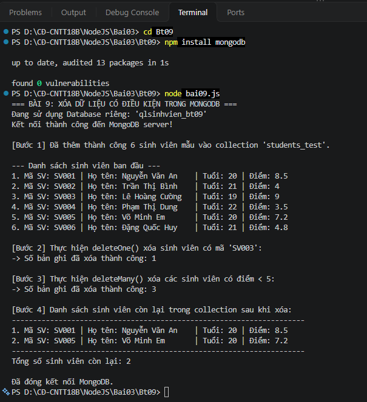
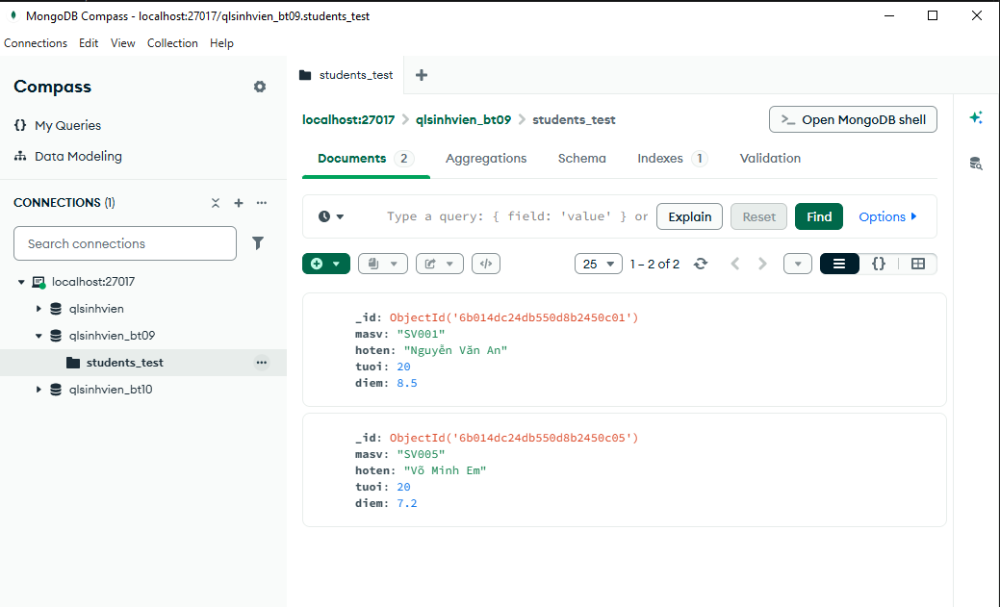

# BÀI 9: XÓA DỮ LIỆU CÓ ĐIỀU KIỆN TRONG MONGODB

## 1. Mục tiêu bài tập

- Kết nối ứng dụng Node.js với cơ sở dữ liệu MongoDB (`mongodb://127.0.0.1:27017`) sử dụng database riêng biệt **`qlsinhvien_bt09`**.
- Tạo và làm việc với collection `students_test`.
- Thêm ít nhất 5 sinh viên mẫu với các trường thông tin: `masv`, `hoten`, `tuoi`, `diem` bằng phương thức `insertMany()`.
- Sử dụng phương thức `deleteOne()` để xóa chính xác 1 bản ghi sinh viên theo điều kiện mã sinh viên (`masv`).
- Sử dụng phương thức `deleteMany()` kết hợp toán tử điều kiện `$lt` để xóa đồng loạt các sinh viên có điểm số dưới 5 (`diem < 5`).
- Hiển thị số lượng bản ghi đã xóa ở mỗi thao tác và truy vấn danh sách sinh viên còn lại trong collection bằng `find()`.

---

## 2. Các lệnh thực hiện

### Bước 1: Di chuyển vào thư mục bài tập

```bash
cd Bt09
```

### Bước 2: Cài đặt thư viện MongoDB Driver (độc lập trong thư mục Bt09)

```bash
npm install mongodb
```

### Bước 3: Chạy chương trình

```bash
node bai09.js
```
---

## 3. Hình ảnh thực hiện

### Hình 1: Kết quả chạy chương trình trên Terminal



---

### Hình 3: Kiểm tra Database `qlsinhvien_bt09` trên MongoDB Compass



---

## 5. Kết quả đạt được

- **Cơ sở dữ liệu và gói thư viện độc lập:** Khởi tạo Database riêng `qlsinhvien_bt09` và bộ quản lý gói `package.json`, `node_modules` riêng biệt ngay trong thư mục `Bt09`.
- **Thêm dữ liệu mẫu:** Chèn thành công 6 bản ghi sinh viên mẫu với đầy đủ các thuộc tính `masv`, `hoten`, `tuoi`, `diem` vào collection `students_test`.
- **Xóa bản ghi đơn lẻ (`deleteOne`):** Xóa chính xác 1 sinh viên có mã `SV003` và hiển thị `deletedCount = 1`.
- **Xóa nhiều bản ghi theo điều kiện (`deleteMany`):** Sử dụng toán tử so sánh `$lt` xóa thành công 3 sinh viên có điểm `< 5` (`SV002`, `SV004`, `SV006`) với `deletedCount = 3`.
- **Truy vấn danh sách sau xóa:** Phương thức `find()` hiển thị chính xác 2 sinh viên còn lại (`SV001` và `SV005`) có điểm số đạt chuẩn (≥ 5).
- **Quản lý kết nối an toàn:** Luôn gọi `client.close()` trong khối `finally` đảm bảo tài nguyên kết nối được giải phóng đúng chuẩn.

---

## 6. Kết luận

Qua bài thực hành, em đã:
1. Nắm vững cú pháp và cơ chế hoạt động của `deleteOne()` và `deleteMany()` trong MongoDB Driver cho Node.js.
2. Hiểu cách áp dụng các toán tử truy vấn điều kiện (Comparison Operators như `$lt`) khi thao tác xóa dữ liệu.
3. Biết cách tổ chức dự án độc lập với `package.json` và kiểm chứng dữ liệu qua MongoDB Compass.
