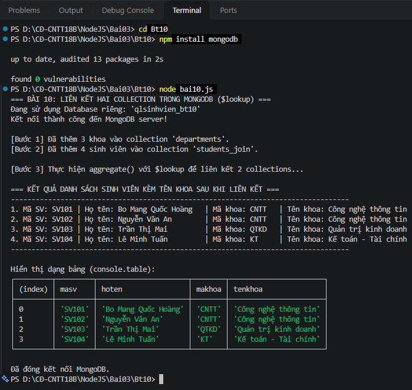
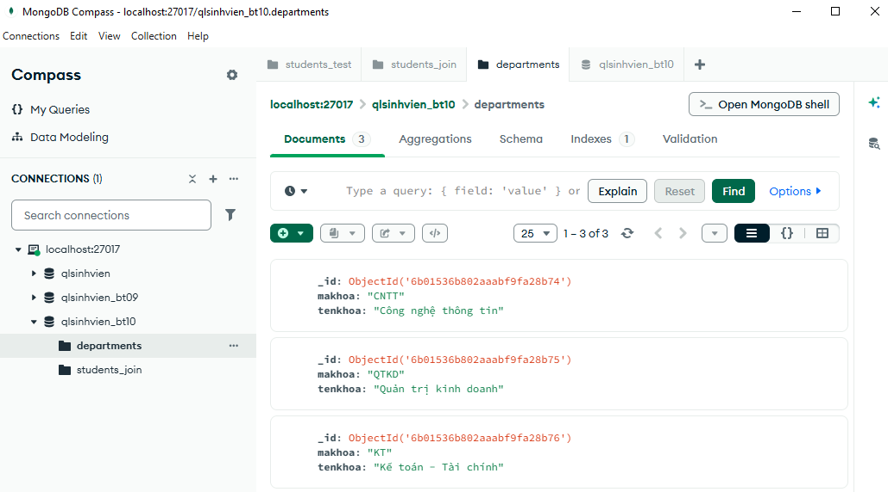
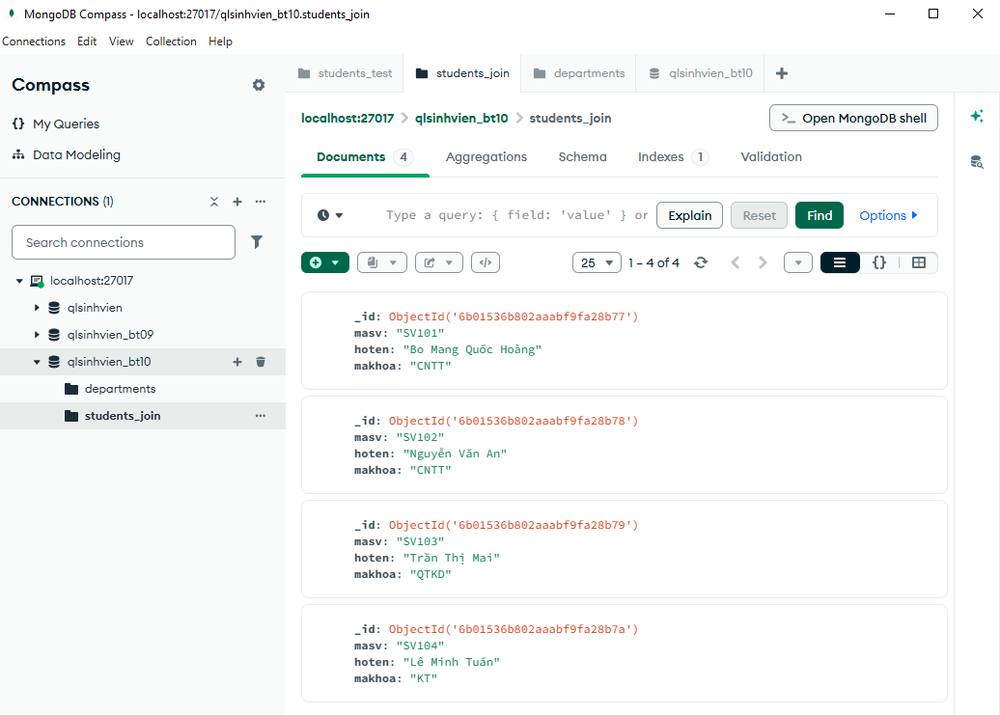

# BÀI 10: LIÊN KẾT HAI COLLECTION TRONG MONGODB

## 1. Mục tiêu bài tập

- Kết nối ứng dụng Node.js với cơ sở dữ liệu MongoDB (`mongodb://127.0.0.1:27017`), sử dụng Database riêng biệt **`qlsinhvien_bt10`**.
- Tạo collection `departments` (khoa) gồm ít nhất 2 khoa, mỗi khoa có các thuộc tính: `makhoa`, `tenkhoa`.
- Tạo collection `students_join` (sinh viên) gồm ít nhất 4 sinh viên, mỗi sinh viên có các trường: `masv`, `hoten`, `makhoa`.
- Sử dụng phương thức `aggregate()` kết hợp toán tử `$lookup` để thực hiện phép nối (JOIN) giữa hai collection thông qua trường liên kết `makhoa`.
- Định dạng và chuẩn hóa dữ liệu bằng `$unwind` và `$project` để kết quả hiển thị không chỉ có mã khoa (`makhoa`) mà còn có đầy đủ tên khoa (`tenkhoa`) tương ứng.

---

## 2. Các lệnh thực hiện

### Bước 1: Di chuyển vào thư mục bài tập

```bash
cd Bt10
```

### Bước 2: Cài đặt thư viện MongoDB Driver (độc lập trong thư mục Bt10)

```bash
npm install mongodb
```

### Bước 3: Chạy chương trình

```bash
node bai10.js
```

---

## 3. Hình ảnh thực hiện

### Hình 1: Kết quả chạy chương trình trên Terminal



---

### Hình 3: Kiểm tra Database `qlsinhvien_bt10` trên MongoDB Compass





---

## 4. Kết quả đạt được

- **Cơ sở dữ liệu và gói thư viện độc lập:** Khởi tạo Database riêng `qlsinhvien_bt10` cùng bộ quản lý gói `package.json`, `node_modules` riêng biệt trong thư mục `Bt10`.
- **Phép nối dữ liệu đa bảng (`$lookup`):** Thực hiện thành công kỹ thuật tương đương `LEFT OUTER JOIN` trong SQL thông qua toán tử `$lookup` của MongoDB Aggregation Framework.
- **Biến đổi dữ liệu (`$unwind`, `$project`):** Sử dụng `$unwind` để giải nén mảng kết quả và `$project` để chỉ chọn lọc những trường cần thiết (`masv`, `hoten`, `makhoa`, `tenkhoa`).
- **Hiển thị trực quan:** Xuất dữ liệu đồng thời dưới dạng danh sách chi tiết và dạng bảng `console.table()` giúp đối soát thông tin sinh viên và khoa dễ dàng.

---

## 5. Kết luận

Qua bài thực hành, em đã:
1. Nắm vững phương pháp thiết kế quan hệ liên kết dữ liệu giữa các Collection trong cơ sở dữ liệu phi quan hệ MongoDB (NoSQL).
2. Hiểu rõ cú pháp và các giai đoạn (pipeline stages) trong `aggregate()`: `$lookup`, `$unwind`, `$project`.
3. Biết cách tổ chức module và dependency độc lập cho từng bài tập, dễ dàng triển khai và nộp bài riêng rẽ.
