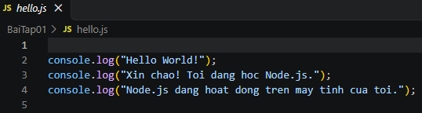
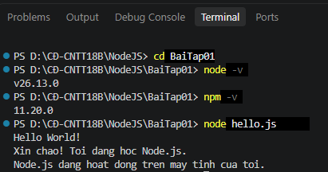

# BÀI TẬP 1: LÀM QUEN VỚI NODE.JS - CHƯƠNG TRÌNH HELLO WORLD

## 1. Mục tiêu bài tập

- Làm quen với môi trường thực thi JavaScript **Node.js** trên máy tính cá nhân.
- Sử dụng trình biên soạn mã **Visual Studio Code (VS Code)** để tạo và quản lý tệp mã nguồn đầu tiên `hello.js`.
- Sử dụng hàm `console.log()` cơ bản để xuất dữ liệu và thông báo ra màn hình điều khiển.
- Mở và thao tác trên cửa sổ dòng lệnh **Terminal** để thực thi tập lệnh Node.js với câu lệnh `node hello.js`.

---

## 2. Các lệnh thực hiện

Di chuyển vào thư mục `BaiTap01`:

```bash
cd BaiTap01
```

Chạy chương trình:

```bash
node hello.js
```

Kết quả mong đợi xuất hiện trên Terminal:

```text
Hello World!
Xin chao! Toi dang hoc Node.js.
Node.js dang hoat dong tren may tinh cua toi.
```

---

## 3. Mã nguồn chương trình (`hello.js`)

Nội dung mã nguồn tệp `hello.js`:

```javascript
console.log("Hello World!");
console.log("Xin chao! Toi dang hoc Node.js.");
console.log("Node.js dang hoat dong tren may tinh cua toi.");
```

**Giải thích mã nguồn:**
- `console.log("Hello World!");`: In dòng thông điệp kinh điển chào mừng khi làm quen với môi trường Node.js.
- `console.log("Xin chao! Toi dang hoc Node.js.");`: In câu thông báo về quá trình học tập lập trình Node.js.
- `console.log("Node.js dang hoat dong tren may tinh cua toi.");`: Xác nhận nền tảng Node.js đã được cài đặt và vận hành chính xác trên máy tính.

---

## 4. Hình ảnh thực hiện

### Hình 1: Mã nguồn chương trình trong Visual Studio Code

Ảnh chụp giao diện soạn thảo mã nguồn `hello.js` trên Visual Studio Code:



*(Tệp ảnh gốc: `ảnh chụp code vs bài 1.png`)*

---

### Hình 2: Kết quả chạy chương trình trên Terminal

Ảnh chụp kết quả thực thi lệnh `node hello.js` hiển thị thành công cả 3 dòng thông báo ra màn hình Terminal:



*(Tệp ảnh gốc: `ảnh chụp kết quả bài 1.png`)*

---

## 5. Kết quả đạt được

- **Cài đặt môi trường:** Môi trường Node.js được thiết lập và vận hành ổn định trên hệ điều hành.
- **Tạo tệp mã nguồn:** Viết và lưu thành công tệp `hello.js` bằng Visual Studio Code với cú pháp JavaScript chuẩn.
- **Thực thi mã nguồn:** Sử dụng thành thạo cửa sổ Terminal tích hợp sẵn trong VS Code để chạy tệp bằng lệnh `node hello.js`.
- **Hiển thị đầu ra:** Các dòng thông báo được in ra màn hình Terminal chính xác theo thứ tự và nội dung, không gặp bất kỳ lỗi cú pháp nào.

---

## 6. Kết luận

Qua bài tập đầu tiên, em đã nắm vững các kiến thức nền tảng:
1. Hiểu được cơ chế hoạt động của Node.js như một môi trường thực thi JavaScript độc lập phía máy tính/server mà không cần dựa vào trình duyệt web.
2. Nắm vững quy trình làm việc từ khâu tạo file, viết mã lệnh trên Visual Studio Code đến khâu chạy và kiểm tra kết quả qua Terminal.
3. Sử dụng thành thạo câu lệnh `console.log()` để xuất dữ liệu và theo dõi luồng xử lý của chương trình.
