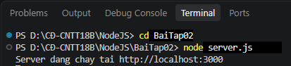
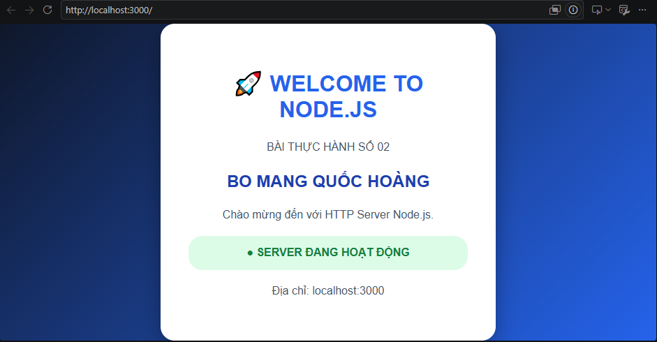

# BÀI TẬP 02 (PHẦN 1): XÂY DỰNG WEB SERVER CƠ BẢN VỚI MODULE HTTP

## 1. Mục tiêu bài tập

- Sử dụng module tích hợp sẵn `http` trong Node.js để khởi tạo một Web Server.
- Cấu hình phản hồi HTTP Header với mã trạng thái `200 OK` và `Content-Type: text/html; charset=utf-8` để hiển thị tiếng Việt có dấu.
- Trả về mã nguồn HTML có nhúng mã định dạng CSS (giao diện dạng card, hiệu ứng gradient, đổ bóng và huy hiệu trạng thái).
- Lắng nghe và xử lý các yêu cầu (requests) tại cổng `3000` (`http://localhost:3000`).

---

## 2. Các lệnh thực hiện

### Bước 1: Di chuyển vào thư mục bài tập

Mở cửa sổ dòng lệnh (Terminal) và chuyển vào thư mục `BaiTap02-p1`:

```bash
cd BaiTap02-p1
```

### Bước 2: Khởi động Web Server

Thực thi tệp mã nguồn `server.js` bằng Node.js:

```bash
node server.js
```

Sau khi chạy lệnh, Terminal sẽ xuất thông báo:
```text
Server dang chay tai http://localhost:3000
```

### Bước 3: Kiểm tra kết quả trên trình duyệt

Mở trình duyệt web (Chrome, Edge, Firefox,...) và truy cập vào đường dẫn:
```text
http://localhost:3000
```

---

## 3. Mã nguồn chương trình (`server.js`)

```javascript
const http = require("http");

const server = http.createServer((req, res) => {
    res.writeHead(200, {
        "Content-Type": "text/html; charset=utf-8"
    });

    res.end(`
        <!DOCTYPE html>
        <html lang="vi">
        <head>
            <meta charset="UTF-8">
            <meta name="viewport" content="width=device-width, initial-scale=1.0">
            <title>Bài tập 02 - Node.js</title>
            <style>
                body {
                    font-family: Arial;
                    background: linear-gradient(135deg, #0f172a, #2563eb);
                    height: 100vh;
                    display: flex;
                    justify-content: center;
                    align-items: center;
                    margin: 0;
                }

                .card {
                    background: white;
                    padding: 40px;
                    border-radius: 20px;
                    text-align: center;
                    width: 400px;
                    box-shadow: 0 10px 30px #0005;
                }

                h1 { color: #2563eb; }
                h2 { color: #1e40af; }
                p { color: #475569; line-height: 1.8; }

                .status {
                    background: #dcfce7;
                    color: #15803d;
                    padding: 10px;
                    border-radius: 20px;
                    font-weight: bold;
                }
            </style>
        </head>
        <body>
            <div class="card">
                <h1>🚀 WELCOME TO NODE.JS</h1>
                <p>BÀI THỰC HÀNH SỐ 02</p>
                <h2>BO MANG QUỐC HOÀNG</h2>
                <p>Chào mừng đến với HTTP Server Node.js.</p>
                <p class="status">● SERVER ĐANG HOẠT ĐỘNG</p>
                <p>Địa chỉ: localhost:3000</p>
            </div>
        </body>
        </html>
    `);
});

server.listen(3000, () => {
    console.log("Server dang chay tai http://localhost:3000");
});
```

**Giải thích mã nguồn:**
- `const http = require("http");`: Nạp module HTTP cốt lõi của Node.js.
- `http.createServer((req, res) => { ... })`: Tạo đối tượng Web Server lắng nghe các yêu cầu từ client.
- `res.writeHead(200, { "Content-Type": "text/html; charset=utf-8" });`: Thiết lập mã HTTP 200 (thành công) và định dạng dữ liệu trả về là văn bản HTML có mã hóa UTF-8.
- `res.end(...)`: Trả về toàn bộ chuỗi HTML/CSS giao diện và kết thúc phiên phản hồi.
- `server.listen(3000, ...)`: Thiết lập server lắng nghe kết nối tại cổng mạng 3000.

---

## 4. Hình ảnh các bước thực hiện

### Hình 1: Khởi động Web Server trên Terminal

Thực thi câu lệnh `node server.js` và xác nhận server đang lắng nghe tại cổng `3000`:



*(Tệp ảnh gốc: `kết quả terminal.png`)*

---

### Hình 2: Kết quả hiển thị trên trình duyệt (http://localhost:3000)

Giao diện trang web chào mừng với thẻ card hiển thị thông tin học viên "BO MANG QUỐC HOÀNG" và trạng thái hoạt động của máy chủ:



*(Tệp ảnh gốc: `kết quả chạy localhost.png`)*

---

## 5. Kết quả đạt được

- Khởi tạo thành công máy chủ Web HTTP Server trên nền tảng Node.js chạy tại cổng `3000`.
- Định cấu hình Header chính xác giúp trang web hiển thị đầy đủ tiếng Việt không bị lỗi font chữ.
- Giao diện được thiết kế hiện đại, bố cục dạng thẻ (card) căn giữa màn hình với dải màu gradient và hiệu ứng đổ bóng trực quan.
- Kết nối thành công giữa trình duyệt web (Client) và máy chủ Node.js (Server) qua địa chỉ `http://localhost:3000`.

---

## 6. Kết luận

Qua bài thực hành số 02 (phần 1), em đã nắm vững:
1. Cách sử dụng module `http` của Node.js để xây dựng ứng dụng web server cơ bản mà không cần cài thêm thư viện ngoài.
2. Quy trình xử lý yêu cầu (Request) và phản hồi (Response) trong giao thức HTTP.
3. Kỹ năng kết hợp HTML/CSS vào phản hồi của máy chủ để phục vụ giao diện người dùng.
