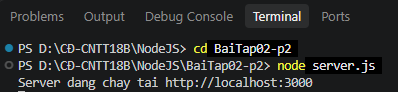
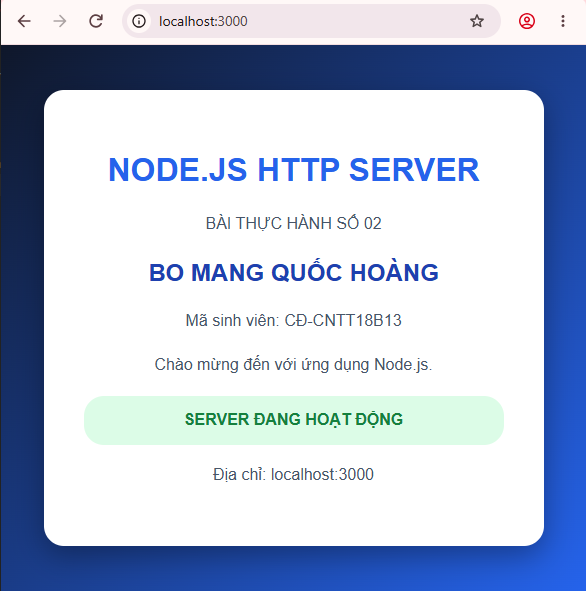

# BÀI TẬP 02 (PHẦN 2): NÂNG CẤP GIAO DIỆN WEB SERVER VÀ THÔNG TIN SINH VIÊN

## 1. Mục tiêu bài tập

- Kế thừa và hoàn thiện ứng dụng Web Server Node.js từ phần 1.
- Bổ sung đầy đủ thông tin định danh sinh viên vào giao diện: Họ và tên (`BO MANG QUỐC HOÀNG`), Mã sinh viên (`CĐ-CNTT18B13`).
- Tối ưu hóa định dạng CSS: Tăng kích thước thẻ card (`width: 420px;`), căn chỉnh khoảng cách chữ, font chữ và kiểu dáng huy hiệu trạng thái.
- Đảm bảo server lắng nghe ổn định tại cổng `3000` (`http://localhost:3000`) và phản hồi giao diện hoàn chỉnh.

---

## 2. Các lệnh thực hiện

### Bước 1: Di chuyển vào thư mục bài tập

Mở cửa sổ dòng lệnh (Terminal) và di chuyển vào thư mục `BaiTap02-p2`:

```bash
cd BaiTap02-p2
```

### Bước 2: Khởi động Web Server

Thực thi tệp mã nguồn `server.js`:

```bash
node server.js
```

Terminal xuất thông báo xác nhận:
```text
Server dang chay tai http://localhost:3000
```

### Bước 3: Kiểm tra kết quả trên trình duyệt

Mở trình duyệt web và truy cập địa chỉ:
```text
http://localhost:3000
```

---

## 3. Mã nguồn chương trình (`server.js`)

```javascript
const http = require("http");

const server = http.createServer((req, res) => {
    res.writeHead(200, {
        "Content-Type": "text/html; charset=utf-8"
    });

    res.end(`
        <!DOCTYPE html>
        <html lang="vi">
        <head>
            <meta charset="UTF-8">
            <meta name="viewport" content="width=device-width, initial-scale=1.0">
            <title>Bài tập 02 - Node.js</title>

            <style>
                body {
                    font-family: Arial;
                    background: linear-gradient(135deg, #0f172a, #2563eb);
                    height: 100vh;
                    display: flex;
                    justify-content: center;
                    align-items: center;
                    margin: 0;
                }

                .card {
                    background: white;
                    padding: 40px;
                    border-radius: 20px;
                    text-align: center;
                    width: 420px;
                    box-shadow: 0 10px 30px #0005;
                }

                h1 {
                    color: #2563eb;
                }

                h2 {
                    color: #1e40af;
                }

                p {
                    color: #475569;
                    line-height: 1.8;
                }

                .status {
                    background: #dcfce7;
                    color: #15803d;
                    padding: 10px;
                    border-radius: 20px;
                    font-weight: bold;
                }
            </style>
        </head>

        <body>
            <div class="card">
                <h1>NODE.JS HTTP SERVER</h1>
                <p>BÀI THỰC HÀNH SỐ 02</p>

                <h2>BO MANG QUỐC HOÀNG</h2>
                <p>Mã sinh viên: CĐ-CNTT18B13</p>

                <p>Chào mừng đến với ứng dụng Node.js.</p>
                <p class="status">SERVER ĐANG HOẠT ĐỘNG</p>
                <p>Địa chỉ: localhost:3000</p>
            </div>
        </body>
        </html>
    `);
});

server.listen(3000, () => {
    console.log("Server dang chay tai http://localhost:3000");
});
```

**Các điểm cải tiến so với phần 1:**
- Tiêu đề chính cập nhật thành: `NODE.JS HTTP SERVER`.
- Bổ sung thông tin định danh sinh viên: `<p>Mã sinh viên: CĐ-CNTT18B13</p>`.
- Điều chỉnh độ rộng của thẻ card (`width: 420px;`), giúp các dòng văn bản bố trí cân đối, thoáng và dễ đọc hơn.
- Cập nhật huy hiệu trạng thái: `SERVER ĐANG HOẠT ĐỘNG`.

---

## 4. Hình ảnh các bước thực hiện

### Hình 1: Khởi động Web Server trên Terminal

Thực thi câu lệnh `node server.js`, máy chủ bắt đầu lắng nghe tại cổng `3000`:



*(Tệp ảnh gốc: `phần terminal của bài.png`)*

---

### Hình 2: Kết quả hiển thị trên trình duyệt (http://localhost:3000)

Giao diện trang web trên trình duyệt hiển thị đầy đủ thông tin sinh viên "BO MANG QUỐC HOÀNG", mã số sinh viên "CĐ-CNTT18B13" và trạng thái hoạt động:



*(Tệp ảnh gốc: `localhost của bài 2p2.png`)*

---

## 5. Kết quả đạt được

- Khởi chạy và vận hành thành công Web Server tại cổng `3000`.
- Hiển thị đầy đủ, chính xác thông tin sinh viên gồm Họ tên và Mã số sinh viên trên giao diện HTML được máy chủ trả về.
- Giao diện CSS được tối ưu hóa hiển thị sắc nét, cân đối và chuyên nghiệp.
- Hoàn thành trọn vẹn yêu cầu bài thực hành số 02 về việc tạo và cấu hình Web Server cơ bản trong Node.js.

---

## 6. Kết luận

Qua chuỗi bài tập số 02 (cả phần 1 và phần 2), em đã:
1. Thành thạo việc tạo một Web Server bằng module `http` trong Node.js.
2. Nắm vững phương pháp nhúng và trả về cấu trúc HTML/CSS để xây dựng giao diện ứng dụng web trực quan.
3. Biết cách cập nhật, tùy biến nội dung động và quản lý thông tin hiển thị trên máy chủ.
